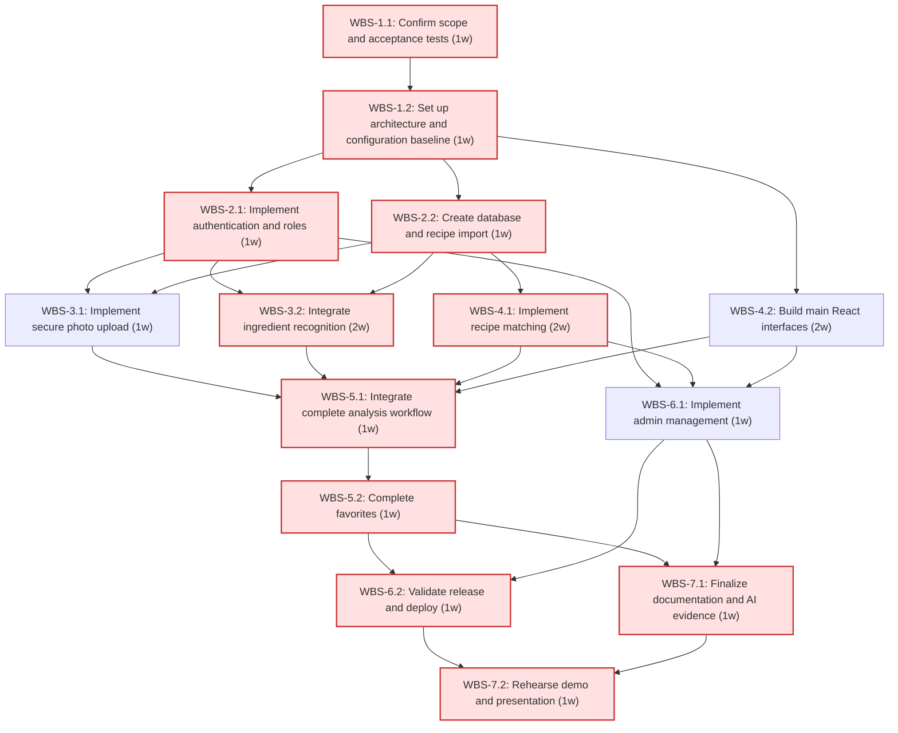
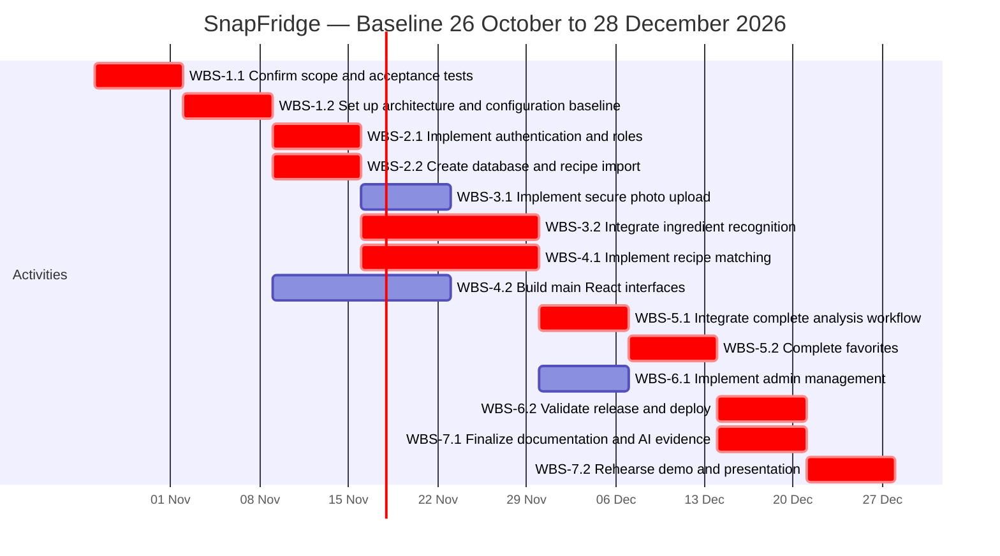

# Software Engineering — Project Plan

## Cover Page

| Field | Details |
|---|---|
| Course | ISE304E – Software Engineering (2026–2027 Fall) |
| Report name | Project Plan |
| Project title | SnapFridge |
| Group name / number | SnapFridge; 2 |
| Group members | Biray Dağlı - 150210211; Ahmet İlker Yıldızlı - 150210215; Umut Uğurlu - 150230213; Talha Arpacık - 150220213; İdil Emiral - 150230223 |
| Instructor | Res. Asst. Dr. Abdullah Cihan AK |
| Submission date | 2026-10-28 |
| Document version | 1.0 |

Repository: https://github.com/ailkery/SnapFridge

## 1. Introduction

### 1.1 Scope

**Project overview:** SnapFridge helps students, employees and home cooks decide what to cook using ingredients already available. Users upload a fridge or kitchen-counter photo, review AI-recognized ingredients and receive relevant recipes. The application aims to reduce avoidable food waste; actual waste reduction is not claimed without a separate user study.

**In scope:**
- Registration, login and server-side User/Admin authorization.
- Photo upload, vision-LLM ingredient recognition and user confirmation/correction of detected ingredients.
- Import of an existing recipe dataset (TheMealDB or a suitable Kaggle dataset) into PostgreSQL after checking permission and attribution requirements.
- Ingredient-based recipe ranking, recipe details and missing-ingredient display.
- Favorite recipes and simple admin recipe management (add, edit, delete).
- FastAPI REST backend, React/Tailwind frontend, PostgreSQL, Render deployment and GitHub Actions CI.
- Tests, documentation, customer-meeting records and human/AI contribution evidence.

**Optional scope:** Analysis history (list of a user's past photo analyses), recipe categories, keyword search and LLM-generated recipe suggestions. Dataset-based matching is the mandatory baseline. Optional work starts only after core acceptance tests pass and must not delay mandatory milestones.

**Out of scope:** Native mobile apps; grocery ordering/payments; social follow/comment/share features; calorie/diet tracking; training a custom vision model. No medical, allergy-safety or food-freshness guarantees.

**Assumptions and constraints:** Five students work part-time alongside other courses. Each member plans about 10 hours/week for project activities (0.25 FTE); one person-week is 40 hours. Report writing and meetings are on top of this. Existing laptops and repository are used. Secrets stay in environment variables; images are transient unless explicit retention is later approved. External APIs require network access and suitable credentials. We start with TheMealDB; if its licence or ingredient coverage is not adequate, we switch to a suitable Kaggle recipe dataset. Cloud hosting and structured database use are mandatory course constraints. Charter milestones remain fixed; the November break and exam workload require early progress and scope control.

### 1.2 Deliverables

| Deliverable ID | Deliverable name | Description / contents | Acceptance criterion |
|---|---|---|---|
| D-01 | Versioned engineering baseline | Repository, CI, API contracts, configuration and acceptance-test baseline. | A clean checkout runs documented checks; a failing check prevents acceptance of a PR. |
| D-02 | Account and data services | Authentication, User/Admin roles, PostgreSQL schema and recipe import script. | Account tests pass; non-admin cannot access admin operations; recipes are loaded into the database by the import script. |
| D-03 | Photo and recognition module | Photo upload, vision API call and editable ingredient list. | A valid photo returns an editable ingredient list; a wrong file type or an API error shows a clear message. |
| D-04 | Recipe recommendation interface | React screens, matching API and recipe details. | Confirmed ingredients produce ranked dataset recipes and show missing ingredients; empty results are explained. |
| D-05 | Favorites | Users save recipes they like. | Users can add/remove favorites and see only their own favorites. |
| D-06 | Admin and deployed release | Admin recipe management and the integrated cloud application. | Admin can add/edit/delete recipes; the main user workflow works on the hosted release. |
| D-07 | Documentation and demonstration package | Course reports, README setup guide, meeting records, AI-usage log, demo and presentation. | Each course report is submitted on time; a team member can run the project from the README; the demo is rehearsed once. |

### 1.3 Functional Requirements / Tasks

| Task ID | Functional requirement / task | Description | Related deliverable ID(s) |
|---|---|---|---|
| T-01 | Establish delivery baseline | Confirm scope, testable acceptance conditions and configuration workflow. | D-01, D-07 |
| T-02 | Manage identities and recipe data | Provide accounts/roles and import recipes. | D-02 |
| T-03 | Recognize photo ingredients | Validate upload, recognize ingredients, permit correction and handle failure. | D-03 |
| T-04 | Suggest and display recipes | Rank recipes using confirmed ingredients and expose accessible web screens. | D-04 |
| T-05 | Integrate workflow and favorites | Connect all parts end to end and store favorites per user. | D-05 |
| T-06 | Administer and release system | Manage recipes and deploy the complete application. | D-06 |
| T-07 | Document and demonstrate product | Maintain documentation/evidence and prepare separate demo and technical presentation. | D-07 |

### 1.4 Non-functional Issues

| Quality attribute | Requirement / concern | How it will be assessed |
|---|---|---|
| Security | Hash passwords; validate JWTs; check User/Admin role on the server; no secrets in the repository; accept only JPEG/PNG up to 10 MB. | Tests that a normal user cannot reach admin endpoints and that wrong files are rejected; PR review. |
| Performance | Normal pages (recipe list, details, favorites) open in about 2 seconds; a photo analysis finishes or shows an error within 30 seconds. | Manual timing on the deployed app with the imported recipe data. |
| Usability | Simple main workflow; loading and error messages are visible; ingredients are editable. | Three classmates try the photo-to-recipe flow and we note their feedback. |
| Reliability | Users see friendly error messages, not crashes; the same recipe cannot be favorited twice. | Tests for API errors and duplicate favorites; smoke test after each deployment. |
| Recognition quality | The AI result is a suggestion; the user always checks and edits the list. | Try 10 sample fridge photos and note what was found correctly and what was missed. |
| Maintainability | Every feature comes with tests and one reviewer's approval; everything is versioned on GitHub. | Each PR links its WBS ID and passes the GitHub Actions tests. |

## 2. Project Plan — Work Breakdown Structure (WBS)

T = Tiny; S = Small; M = Medium; L = Large; XL = Extra-large.

| WBS activity ID | Parent task ID | Activity / subtask | Description / completion condition | Size (T/S/M/L/XL) |
|---|---|---|---|---|
| WBS-1.1 | T-01 | Confirm scope and acceptance tests | Agree MVP boundaries; draft positive and negative acceptance tests and record customer feedback. | M |
| WBS-1.2 | T-01 | Set up architecture and configuration baseline | Create the repository structure, a list of API endpoints, a first database sketch and a GitHub Actions workflow that runs tests. | M |
| WBS-2.1 | T-02 | Implement authentication and roles | Test and implement registration, login, password hashing, JWT validation and server-side User/Admin permissions. | M |
| WBS-2.2 | T-02 | Create database and recipe import | Create the tables and a script that loads recipes and their ingredients from the dataset. | M |
| WBS-3.1 | T-03 | Implement photo upload | Accept JPEG/PNG up to 10 MB from logged-in users, do not store the image, and test wrong files. | M |
| WBS-3.2 | T-03 | Integrate ingredient recognition | Send the photo to a vision API, turn the answer into an ingredient list matching dataset names, and handle errors and timeouts. | L |
| WBS-4.1 | T-04 | Implement recipe matching | Rank recipes by how many of their ingredients the user has, return missing ingredients and recipe details; test with sample data. | L |
| WBS-4.2 | T-04 | Build main React interfaces | Implement login, upload, editable ingredient list, recipe results/detail and API adapters using sample API responses. | L |
| WBS-5.1 | T-05 | Integrate complete analysis workflow | Connect frontend, recognition and matching; the photo-to-recipe flow works end to end. | M |
| WBS-5.2 | T-05 | Complete favorites | Add/remove/list favorites for the logged-in user and connect the UI; test that users see only their own favorites. | M |
| WBS-6.1 | T-06 | Implement admin management | Admin page to add, edit and delete recipes; test that normal users are denied. | M |
| WBS-6.2 | T-06 | Validate release and deploy | Run all tests and a manual check of the main flow on Render; fix blocking bugs; freeze code by 21 December. | M |
| WBS-7.1 | T-07 | Finalize documentation and AI evidence | Finish the README, meeting records, contribution log and AI-usage log. | M |
| WBS-7.2 | T-07 | Rehearse demo and presentation | Prepare slides, rehearse the demo once and record a backup video. | M |

**WBS decomposition notes:** Each task is divided into two independently checkable activities. Feature owners write tests before implementation and keep evidence in the repository; WBS-6.2 consolidates system validation rather than postponing all testing. Each activity includes implementation, review and fixes. Documentation, customer feedback and AI-use entries are updated throughout; WBS-7.1 consolidates them. User stories belong in the separate requirements document.

## 3. Estimates

| WBS activity ID | Size | Estimated effort (man-weeks) | Basis / assumptions |
|---|---|---|---|
| WBS-1.1 | M | 0.25 | 1 calendar week × 0.25 FTE; 10 hours including tests/review. |
| WBS-1.2 | M | 0.25 | 1 calendar week × 0.25 FTE; 10 hours including tests/review. |
| WBS-2.1 | M | 0.25 | 1 calendar week × 0.25 FTE; 10 hours including tests/review. |
| WBS-2.2 | M | 0.25 | 1 calendar week × 0.25 FTE; 10 hours including tests/review. |
| WBS-3.1 | M | 0.25 | 1 calendar week × 0.25 FTE; 10 hours including tests/review. |
| WBS-3.2 | L | 0.50 | 2 calendar weeks × 0.25 FTE; 20 hours including tests/review. |
| WBS-4.1 | L | 0.50 | 2 calendar weeks × 0.25 FTE; 20 hours including tests/review. |
| WBS-4.2 | L | 0.50 | 2 calendar weeks × 0.25 FTE; 20 hours including tests/review. |
| WBS-5.1 | M | 0.25 | 1 calendar week × 0.25 FTE; 10 hours including tests/review. |
| WBS-5.2 | M | 0.25 | 1 calendar week × 0.25 FTE; 10 hours including tests/review. |
| WBS-6.1 | M | 0.25 | 1 calendar week × 0.25 FTE; 10 hours including tests/review. |
| WBS-6.2 | M | 0.25 | 1 calendar week × 0.25 FTE; 10 hours including tests/review. |
| WBS-7.1 | M | 0.25 | 1 calendar week × 0.25 FTE; 10 hours including tests/review. |
| WBS-7.2 | M | 0.25 | 1 calendar week × 0.25 FTE; 10 hours including tests/review. |
| Total | — | 4.25 | 170 person-hours; 17 activity-weeks at 0.25 FTE. |

**Estimation method:** Bottom-up estimates use M = 10 hours (0.25 person-week) and L = 20 hours (0.50 person-week). For re-estimation, T = 3 hours, S = 5 hours and XL = 40 hours; split XL activities before scheduling. AI coding assistants are expected to shorten routine coding; review time is included in each estimate. Sizes are effort estimates, not complexity guarantees. Estimates include tests and review and should be revised after the first integration milestone.

**Effort versus duration:** At 0.25 FTE, a 0.50-person-week activity spans two calendar weeks. Parallel tasks reduce elapsed time only when separate members are available. The baseline contains 4.25 person-weeks of effort across nine calendar weeks; these are different quantities.

## 4. Resources

### 4.1 Team Structure and Member Roles

| Member | Student ID | Role(s) | Main responsibilities |
|---|---|---|---|
| Biray Dağlı | 150210211 | Project Manager + Backend Developer | Own scope, planning and backend integration; coordinate acceptance with the instructor/customer. |
| Ahmet İlker Yıldızlı | 150210215 | Configuration Manager + Frontend Developer | Maintain GitHub workflow, CI/configuration and React interface; own release/demo configuration. |
| Umut Uğurlu | 150230213 | Test Manager + Backend Developer | Define test strategy, acceptance tests, backend test review and system/security validation. |
| Talha Arpacık | 150220213 | Documentation Lead + AI Integration Developer | Build vision adapter; maintain reports and AI contribution/review/error evidence. |
| İdil Emiral | 150230223 | Communication Lead + Database Developer | Own data model/import and data services; organize and record team/customer communication. |

### 4.2 Member-to-Activity Assignment

| WBS activity ID | Assigned member | Responsibility | Allocation to activity (FTE) |
|---|---|---|---|
| WBS-1.1 | Umut Uğurlu | Confirm scope and acceptance tests; coordinate necessary peer review. | 0.25 |
| WBS-1.2 | Ahmet İlker Yıldızlı | Set up architecture and configuration baseline; coordinate necessary peer review. | 0.25 |
| WBS-2.1 | Biray Dağlı | Implement authentication and roles; coordinate necessary peer review. | 0.25 |
| WBS-2.2 | İdil Emiral | Create database and recipe import; coordinate necessary peer review. | 0.25 |
| WBS-3.1 | Biray Dağlı | Implement photo upload; coordinate necessary peer review. | 0.25 |
| WBS-3.2 | Talha Arpacık | Integrate ingredient recognition; coordinate necessary peer review. | 0.25 |
| WBS-4.1 | İdil Emiral | Implement recipe matching; coordinate necessary peer review. | 0.25 |
| WBS-4.2 | Ahmet İlker Yıldızlı | Build main React interfaces; coordinate necessary peer review. | 0.25 |
| WBS-5.1 | Biray Dağlı | Integrate complete analysis workflow; coordinate necessary peer review. | 0.25 |
| WBS-5.2 | Umut Uğurlu | Complete favorites; coordinate necessary peer review. | 0.25 |
| WBS-6.1 | İdil Emiral | Implement admin management; coordinate necessary peer review. | 0.25 |
| WBS-6.2 | Umut Uğurlu | Validate release and deploy; coordinate necessary peer review. | 0.25 |
| WBS-7.1 | Talha Arpacık | Finalize documentation and AI evidence; coordinate necessary peer review. | 0.25 |
| WBS-7.2 | Ahmet İlker Yıldızlı | Rehearse demo and presentation; coordinate necessary peer review. | 0.25 |

**Availability or allocation constraints:** No member owns overlapping scheduled activities, and each member has two or three activities. Allocations are weekly averages. At 10 hours/member/week the nine-week capacity is 450 hours; 170 hours are committed to baseline activities and the rest is kept for course reports, reviews, meetings, exams and delays. Actual availability must be checked weekly, especially around the 18 November break and 25 November midterm. Review effort fits inside the activity estimate and the reviewer’s uncommitted capacity.

**Collaboration and configuration:** Use GitHub Issues/Projects with Backlog → Ready → In progress → Review/Test → Done. Each card identifies task/WBS, owner, acceptance conditions and evidence. Use short feature branches, reviewed PRs, CI checks and tagged release baselines. Ahmet manages configuration; no secrets enter source control. Communication: a weekly 30-minute online team meeting and one agreed messaging channel; İdil records decisions and blockers. Biray owns scope changes: a new request is written down, its effort is estimated and the customer decides before anyone implements it.

**Customer and AI evidence:** Customer meetings are held on scope/plan, requirements, design and tests. İdil records the date, attendees, needs and decisions of each meeting and gets the customer's confirmation. Each member keeps their work visible through commits, issues and reviews. For every use of an AI coding assistant (e.g. Claude Code, Copilot), we log the WBS item, tool, what it produced, AI time, human review time, errors it introduced and how we found and fixed them. AI time is reported separately from human effort.

## 5. Schedule

### 5.1 PERT Chart — Activity Sequence

Durations are deterministic calendar-week estimates; this is an activity-on-node dependency network, not a three-point probabilistic PERT estimate. All predecessors must finish before the successor starts.

| Activity | Predecessors | Duration (weeks) | Start | Finish (exclusive) | Total float (weeks) |
|---|---|---|---|---|---|
| WBS-1.1 | None | 1 | 2026-10-26 | 2026-11-02 | 0 |
| WBS-1.2 | WBS-1.1 | 1 | 2026-11-02 | 2026-11-09 | 0 |
| WBS-2.1 | WBS-1.2 | 1 | 2026-11-09 | 2026-11-16 | 0 |
| WBS-2.2 | WBS-1.2 | 1 | 2026-11-09 | 2026-11-16 | 0 |
| WBS-3.1 | WBS-2.1, WBS-2.2 | 1 | 2026-11-16 | 2026-11-23 | 1 |
| WBS-3.2 | WBS-2.1, WBS-2.2 | 2 | 2026-11-16 | 2026-11-30 | 0 |
| WBS-4.1 | WBS-2.2 | 2 | 2026-11-16 | 2026-11-30 | 0 |
| WBS-4.2 | WBS-1.2 | 2 | 2026-11-09 | 2026-11-23 | 1 |
| WBS-5.1 | WBS-3.1, WBS-3.2, WBS-4.1, WBS-4.2 | 1 | 2026-11-30 | 2026-12-07 | 0 |
| WBS-5.2 | WBS-5.1 | 1 | 2026-12-07 | 2026-12-14 | 0 |
| WBS-6.1 | WBS-2.1, WBS-4.1, WBS-4.2 | 1 | 2026-11-30 | 2026-12-07 | 1 |
| WBS-6.2 | WBS-5.2, WBS-6.1 | 1 | 2026-12-14 | 2026-12-21 | 0 |
| WBS-7.1 | WBS-5.2, WBS-6.1 | 1 | 2026-12-14 | 2026-12-21 | 0 |
| WBS-7.2 | WBS-6.2, WBS-7.1 | 1 | 2026-12-21 | 2026-12-28 | 0 |

**PERT notes:** Database work and authentication run in parallel. Vision recognition and recipe matching then run in parallel while the frontend uses sample API responses. Integration waits for all four required components. Favorites follow integration; admin work runs alongside integration. Test/release and final documentation run in parallel after feature completion. Dates use half-open intervals: an activity ending 2026-11-16 finishes by the end of 2026-11-15 and its successor may start on 2026-11-16.

### 5.2 Critical Path and Total Project Duration

There are multiple equal-length critical paths. One is:

`WBS-1.1 → WBS-1.2 → WBS-2.2 → WBS-4.1 → WBS-5.1 → WBS-5.2 → WBS-6.2 → WBS-7.2`

| Critical-path activity ID | Duration (weeks) | Reason it is critical |
|---|---|---|
| WBS-1.1 | 1 | Zero total float; delays the final preparation finish unless recovered. |
| WBS-1.2 | 1 | Zero total float; delays the final preparation finish unless recovered. |
| WBS-2.2 | 1 | Zero total float; delays the final preparation finish unless recovered. |
| WBS-4.1 | 2 | Zero total float; delays the final preparation finish unless recovered. |
| WBS-5.1 | 1 | Zero total float; delays the final preparation finish unless recovered. |
| WBS-5.2 | 1 | Zero total float; delays the final preparation finish unless recovered. |
| WBS-6.2 | 1 | Zero total float; delays the final preparation finish unless recovered. |
| WBS-7.2 | 1 | Zero total float; delays the final preparation finish unless recovered. |

**Total project schedule:** **9 weeks**, from **2026-10-26** to **2026-12-28** (finish boundary). The external demo/presentation occurs **2026-12-30 at 12:30**, leaving two calendar days after preparation; this reserve is outside the nine-week network.

**Critical-path explanation:** The displayed path totals 1+1+1+2+1+1+1+1 = 9 weeks. WBS-2.1 → WBS-3.2 forms an equally long branch from WBS-1.2 to WBS-5.1; WBS-2.2 also precedes WBS-3.2. WBS-7.1 is parallel and equal in duration to WBS-6.2, so replacing WBS-6.2 with WBS-7.1 also yields a critical path. Highlighted nodes are the union of these critical paths. WBS-3.1, WBS-4.2 and WBS-6.1 each have one week of dependency float. Resource conflicts must still be checked before consuming float.

### 5.3 Gantt Chart — Project Timeline

**Course milestones (from the charter; Europe/Istanbul):**

| Milestone | Deadline | Planned preparation / evidence |
|---|---|---|
| Project Charter | 2026-10-13 23:59 | Charter used as the baseline for this plan. |
| Project Plan | 2026-10-28 23:59 | This document. |
| Requirement Specification Report | 2026-11-10 23:59 | Confirm requirements and test examples during WBS-1.1/1.2; refine during early implementation. |
| Requirement Analysis Report | 2026-11-24 23:59 | Maintain model/API and data-flow analysis during WBS-2.2/3.2/4.1. |
| Software Design Report | 2026-12-08 23:59 | Consolidate architecture, schema and interface decisions before the deadline; do not defer to WBS-7.1. |
| Software Test Report | 2026-12-22 23:59 | Incremental test evidence; WBS-6.2 finishes by 20 December; freeze by 21 December and submit report by 22 December. |
| Codebase | 2026-12-27 23:59 | Tested cloud release by 21 December; only reviewed blocking fixes after freeze; final tag before deadline. |
| Demo and Presentation | 2026-12-30 12:30 | WBS-7.2 completes by 27 December; maintain separate user demo and technical presentation. |

**Schedule consistency check:** All 14 WBS activities have estimates, owners, predecessors and matching Gantt dates. Each uses effort = duration × 0.25 FTE. No owner exceeds 0.25 FTE in any scheduled week. The dependency network finishes at week 9. Required report work is continuous and uses uncommitted capacity before each milestone; WBS-7.1 is final consolidation, not the start of reporting. Weekly reviews update estimates, record actual effort and verify milestone readiness. The charter's exact deadlines are the baseline; later instructor announcements take precedence if changed.

## 6. Risks

### 6.1 Risk Impact / Probability Chart

Both probability and impact use 1 (lowest) to 5 (highest). Register order is ascending probability, then impact. Scores prioritize review and are planning judgments.

| Risk ID | Risk description | Probability (1–5) | Impact (1–5) | Risk score (P × I) | Affected WBS activity ID(s) |
|---|---|---|---|---|---|
| R-01 | Credentials or private images exposed | 2 | 5 | 10 | WBS-3.1, WBS-6.2 |
| R-02 | Hosting failure or unexpected service cost | 3 | 3 | 9 | WBS-6.2, WBS-7.2 |
| R-03 | Dataset permissions, quality or coverage inadequate | 3 | 4 | 12 | WBS-2.2, WBS-4.1 |
| R-04 | Vision provider quota, timeout or malformed output | 3 | 4 | 12 | WBS-3.2, WBS-5.1 |
| R-05 | AI-generated implementation introduces hidden defects | 3 | 4 | 12 | WBS-2.1, WBS-3.2, WBS-6.2 |
| R-06 | Exam workload or unavailable member delays critical work | 3 | 5 | 15 | WBS-3.2, WBS-4.1, WBS-6.2 |
| R-07 | Ambiguous photos cause incorrect ingredient recognition | 4 | 3 | 12 | WBS-3.2, WBS-5.1 |
| R-08 | Scope growth after customer feedback | 4 | 4 | 16 | WBS-1.1, WBS-5.2, WBS-7.2 |

| Impact ↓ / Probability → | 1 (Very low) | 2 (Low) | 3 (Medium) | 4 (High) | 5 (Very high) |
|---|---|---|---|---|---|
| 1 — Very low | — | — | — | — | — |
| 2 — Low | — | — | — | — | — |
| 3 — Medium | — | — | R-02 | R-07 | — |
| 4 — High | — | — | R-03, R-04, R-05 | R-08 | — |
| 5 — Very high | — | R-01 | R-06 | — | — |

### 6.2 Risk Mitigation / Aversion Plan

| Risk ID | Related WBS activity ID(s) | Mitigation / avoidance strategy | Responsible member | Contingency if risk occurs |
|---|---|---|---|---|
| R-01 | WBS-3.1, WBS-6.2 | Keep secrets server-side; validate uploads; delete transient images; review access checks. | Umut Uğurlu | Revoke/rotate credentials, remove exposed content, fix access defect and retest before release. |
| R-02 | WBS-6.2, WBS-7.2 | Check service limits and budget early; rehearse cloud deployment and retain local run instructions. | Ahmet İlker Yıldızlı | Restore the verified build or alternate approved cloud configuration; use recorded demo only as presentation fallback, not as cloud-delivery replacement. |
| R-03 | WBS-2.2, WBS-4.1 | Check the dataset licence and try a small import early in WBS-2.2. | İdil Emiral | Switch to a Kaggle dataset or a smaller hand-picked recipe set with the same tables. |
| R-04 | WBS-3.2, WBS-5.1 | Use a provider adapter, bounded calls and structured response validation; mock failure cases. | Talha Arpacık | Offer manual ingredient entry for continuity and cached labeled demo results; restore actual recognition before core acceptance. |
| R-05 | WBS-2.1, WBS-3.2, WBS-6.2 | Write tests first, review generated changes and log AI errors and corrections. | Umut Uğurlu | Revert defective changes; reproduce failure with a regression test and apply reviewed correction. |
| R-06 | WBS-3.2, WBS-4.1, WBS-6.2 | Review availability weekly; pair on critical modules; record handover notes and use uncommitted capacity. | Biray Dağlı | Reassign work with impact review; drop optional generation and escalate threatened mandatory milestones early. |
| R-07 | WBS-3.2, WBS-5.1 | Require ingredient confirmation/editing; evaluate on labeled varied-lighting photos. | Talha Arpacık | Use corrected/manual ingredients and report measured recognition limitations; do not represent guesses as verified contents. |
| R-08 | WBS-1.1, WBS-5.2, WBS-7.2 | Keep a small core scope; every new request goes to the optional list first. | Biray Dağlı | Postpone optional features; change the plan only after the customer agrees. |

**Review cadence:** Review risks weekly and at each customer checkpoint. Owners record triggers, actions and residual risks in GitHub Issues.
